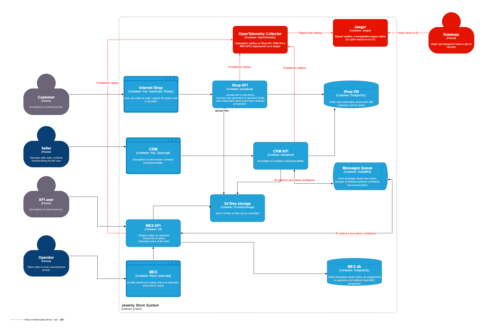
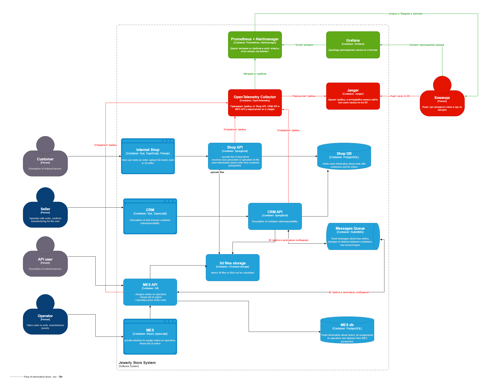

# Архитектурное решение по трейсингу

## Где заказ может сломаться или зависнуть

1. **Shop API → Shop DB.** Покупатель создаёт заказ (`INITIATED` → `SUBMITTED`). Может упасть при сохранении.
2. **Shop API → S3.** Загрузка 3D-модели (`FILE_UPLOADED`). Файл может не загрузиться.
3. **CRM API ← Shop DB.** CRM забирает заказ прямо из базы магазина. Если не забрал, дальше заказ не идёт.
4. **RabbitMQ между CRM и MES.** Сообщение может не отправиться, пропасть в очереди или упасть при обработке.
5. **MES API: расчёт цены.** Идёт 2–30 минут и может зависнуть (`PRICE_CALCULATED` не наступает).
6. **MES API ← партнёры.** Заказ по API: MES считает цену и отправляет сообщение в CRM, где создаётся заказ. Если сообщение потерялось, заказа в CRM нет.
7. **CRM: подтверждение продавцом** (`MANUFACTURING_APPROVED`). Заказ может висеть, пока продавец не подтвердит.
8. **MES: производство** (`MANUFACTURING_STARTED` … `SHIPPED`). Заказ может висеть, пока его не взял оператор.

## Какие системы покрываем трейсингом

Shop API, CRM API, MES API и RabbitMQ. Обращения к БД и S3 попадают в трейсинг как шаги внутри них.

Фронтенды не покрываем: заказ начинается с API.

На схеме Shop API, CRM API и MES API отмечены красными стрелками «Отправляет трейсы», RabbitMQ — красными подписями «ID трейса в заголовках сообщения»: [картинка схемы](container-diagram-tracing.png), [исходник drawio](container-diagram-tracing.drawio).

## Данные в трейсинге

Время, длительность, результат шага, ошибка, сервис, trace ID и span ID трейсинг записывает сам. Вручную к шагам добавляем то, чего он не знает:

- ID заказа;
- статус заказа;
- ID партнёра, если заказ по API;
- для сообщений: ID сообщения;
- для расчёта цены: размер 3D-модели (число полигонов);
- для производства: какой оператор взял заказ.

Личные данные клиентов (имена, адреса, телефоны) в трейсинг не попадают.

## Мотивация

**Сейчас потерянный заказ невозможно найти.** Заказ проходит через магазин, CRM, MES и RabbitMQ. Когда он застревает, никто не знает, на каком шаге. Поэтому единичные потерянные заказы не расследуют вообще: искать их слишком долго.

**Что даст трейсинг:**
* **Видно, где заказ сейчас и что с ним было.** По ID заказа открываем его путь через все системы и находим шаг, на котором он сломался или завис. Застрявший заказ можно точечно довести до конца.
* **Быстрее находим и чиним проблему.** Время на поиск причины сокращается с часов и дней до минут.
* **Быстрее диагностируем баги.** Видно, какой сервис и какой запрос дал ошибку, не нужно воспроизводить её вручную.
* **Команды не перекидывают проблему друг другу.** Сразу видно, в какой системе сбой, и спор «это не у нас» не возникает.

Всё это напрямую экономит деньги: меньше потерянных заказов и ушедших клиентов, меньше времени команды на разбирательства.

**Метрики, на которые повлияет трейсинг:**

| Метрика | Тип | Как изменится |
|---|---|---|
| Время поиска причины проблемы | Техническая | Сократится: шаг со сбоем виден сразу |
| Время устранения проблемы (от обнаружения до исправления) | Техническая | Сократится: не нужно воспроизводить ошибку |
| Количество заказов в неизвестном состоянии | Техническая | Упадёт: для каждого заказа видно, где он |
| Доля просроченных заказов | Бизнес | Упадёт: зависшие заказы находятся и доводятся до конца |
| Количество жалоб клиентов и партнёров на потерянные заказы | Бизнес | Упадёт |

## Предлагаемое решение

**Технологии:** OpenTelemetry для сбора трейсов, OpenTelemetry Collector для их приёма, Jaeger для хранения и просмотра.

**Новые компоненты:**
1. **OpenTelemetry Collector** — принимает трейсы от Shop API, CRM API и MES API и пересылает их в Jaeger.
2. **Jaeger** — хранит трейсы, в интерфейсе можно найти все шаги заказа по его ID.

**Что дорабатываем:**

3. **Shop API и CRM API (Spring Boot)** — подключить OpenTelemetry для Java, добавить к шагам ID заказа и статус.
4. **MES API (C#)** — подключить OpenTelemetry для .NET, добавить ID заказа, статус, ID партнёра, число полигонов модели и оператора.
5. **Обмен через RabbitMQ (CRM API и MES API)** — при отправке сообщения класть в его заголовки ID трейса, при получении — продолжать тот же трейс. Без этого цепочка обрывается на очереди.

**Хранение.** Заказ живёт несколько недель, поэтому трейсы храним не меньше двух месяцев. Иначе к моменту жалобы начало пути заказа уже удалится.

**Схема** (новые элементы выделены красным):

Исходник схемы: [container-diagram-tracing.drawio](container-diagram-tracing.drawio)

### Мониторинг прохождения заказа и алертинг

Считаем метрики из трейсов → смотрим в Grafana → алертим через Alertmanager.

1. **Считаем метрики из трейсов.** Collector пересчитывает трейсы, которые через него проходят, и превращает их в числа: сколько заказов перешло в каждый статус, сколько шагов закончилось ошибкой, сколько длился каждый шаг. Эти числа он отправляет в Prometheus из Task2. Сами трейсы по-прежнему уходят в Jaeger.
2. **Смотрим в Grafana.** Дашборд показывает, сколько заказов за час перешло в каждый статус. Если на каком-то статусе число падает до нуля, заказы застряли там.
3. **Алертим через Alertmanager** — по схеме из Task2 (warning в Telegram, alarm звонком с эскалацией):
   - заказы перестали переходить в следующий статус, например `SUBMITTED` идут, а `PRICE_CALCULATED` нет больше часа;
   - выросла доля ошибок на каком-то шаге;
   - шаг идёт дольше обычного, например расчёт цены дольше 30 минут.

**Схема с мониторингом прохождения заказа** (новые элементы выделены зелёным):

Исходник схемы: [container-diagram-tracing-monitoring.drawio](container-diagram-tracing-monitoring.drawio)

## Компромиссы

1. **Система партнёров.** Трейс начинается на входе в MES API. Потерю заказа на стороне партнёра мы не увидим.
2. **MES — купленная система.** OpenTelemetry придётся встраивать в чужой код силами одного C#-разработчика. Это долго и дорого, а обновление от поставщика может затереть доработки.
3. **CRM читает заказы прямо из Shop DB.** Через чтение таблицы ID трейса не передаётся, цепочка обрывается. Чтобы её сохранить, нужно хранить ID трейса в строке заказа — доработка обеих систем.
4. **Ручные шаги.** Подтверждение продавцом и работа оператора видны только как ожидание: видно, что заказ завис, но не видно почему.
5. **Внешние и облачные сервисы.** Транспортная компания, PostgreSQL и S3 в Яндекс Облаке внутри не трейсятся, видно только наше обращение к ним.
6. **Цена хранения.** Нужен путь каждого заказа, поэтому трейсы по заказам пишем все, без выборки, и храним два месяца. Это заметные расходы на хранилище.
7. **Фронтенды.** Ошибку в браузере, из-за которой запрос не дошёл до API, трейсинг не увидит.

## Безопасность

**Внутри компании**

1. **Вход только по корпоративной учётной записи.** У Jaeger нет своей авторизации, поэтому ставим перед ним прокси с входом через корпоративные учётки. Уволился человек — учётку отключили, и доступ пропал сам.
2. **Доступ только по роли «Поддержка».** Роль получают разработчики и DevOps. Продавцам и операторам трейсы не нужны.
3. **Шифрование при передаче.** Сервисы отправляют трейсы в Collector, а Collector в Jaeger по TLS. Подслушать трафик внутри сети не получится.

**Снаружи**

4. **Jaeger и Collector закрыты от интернета.** Они доступны только из внутренней сети или по VPN. Партнёрам и клиентам трейсы не показываем: о статусе заказа им рассказывает менеджер.

**Данные**

5. **Никаких личных данных.** Имена, адреса и телефоны клиентов в трейсы не пишем.
6. **Хранение два месяца.** Старые трейсы удаляются автоматически.
