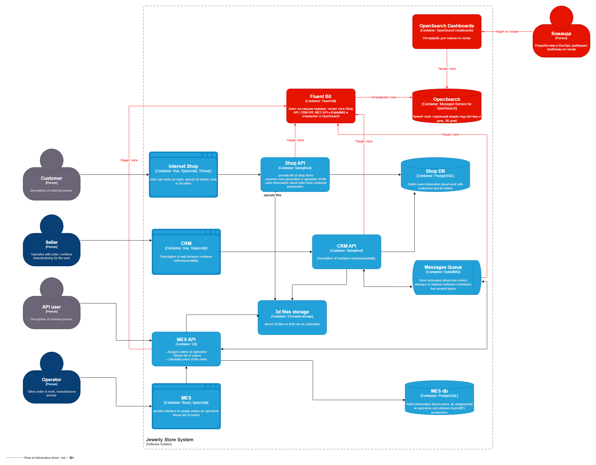

# Архитектурное решение по логированию

## Какие логи собираем

**Системы:** Shop API, CRM API, MES API и RabbitMQ (его собственные логи ошибок и отключений). Фронтенды не берём.

На схеме эти системы отмечены красными стрелками «Пишет логи»: [картинка схемы](container-diagram-logging.png), [исходник drawio](container-diagram-logging.drawio).

**Логи уровня INFO:**
- **Заказ создан** — ID заказа, ID покупателя, источник (магазин или партнёр), ID партнёра.
- **Партнёр прислал заказ через API** — ID партнёра, ID заказа. Показывает, дошёл ли запрос партнёра до нас.
- **Смена статуса заказа** — время, ID заказа, ID покупателя, новый статус, ID того, кто перевёл (покупатель, продавец, оператор или система).
- **Передача заказа другому оператору** — время, ID заказа, кто передал, от кого и кому.
- **3D-модель загружена** — ID заказа, размер файла, число полигонов.
- **Расчёт цены начат и закончен** — ID заказа, длительность расчёта.
- **Сообщение отправлено и получено** — ID заказа, ID сообщения. Видно, где пропало сообщение.

**Другие уровни:**
- **WARN** — проблема, с которой система справилась: повторная попытка обработки сообщения, расчёт цены дольше 30 минут, пропущенный дубль сообщения.
- **ERROR** — операция не выполнилась: заказ не сохранился, файл не загрузился, сообщение ушло в DLQ, ответ 500.
- **DEBUG** — в prod выключен, включаем временно для одного сервиса при разборе проблемы. В dev включен всегда.

## Мотивация

**Сейчас проблемы разбираются со слов клиента.** Что произошло на стороне сервиса, не видно, и разработчики с поддержкой тратят на разбор много времени.

**Что даст логирование:**
* **Видно, что прислал партнёр.** По логам можно точно сказать, дошёл ли заказ партнёра через API и что в нём было. Споры «мы отправляли — вы не получили» решаются фактами.
* **Видно, что делал оператор.** Кто взял заказ и кому передал — это записано. Споры операторов о вознаграждении уходят.
* **Видна история заказа.** Что с ним происходило, где и когда.
* **Проще находить и чинить баги.** Ошибка записана вместе с контекстом, не нужно воспроизводить её со слов клиента.

Меньше времени разработчиков на разбор — меньше расходов.

**Метрики, на которые повлияет логирование:**

| Метрика | Тип | Как изменится |
|---|---|---|
| Время разбора проблемы | Техническая | Сократится: причина видна в логах |
| Время разработчиков на обращения поддержки | Техническая | Сократится |
| Количество споров с партнёрами о непришедших заказах | Бизнес | Упадёт: есть доказательства |
| Время ответа клиенту на вопрос «где мой заказ» | Бизнес | Сократится |

## Очерёдность внедрения логирования и трейсинга

1. **MES API и обмен сообщениями в CRM API.** Через MES идут заказы партнёров, расчёт цены и производство. Здесь теряются заказы и из-за этого уходят контракты. Обмен в CRM покрываем сразу, иначе не увидим, дошло ли сообщение.
2. **RabbitMQ.** Он уже пишет свои логи в файл — перезапуски, отключения получателей, ошибки. Их нужно только начать собирать, код менять не надо. По ним видно, когда могли пропасть сообщения.
3. **Остальной CRM API.** Подтверждение заказов продавцами.
4. **Shop API.** Проблем с заказами из магазина меньше, а поведение покупателей на сайте частично видит Яндекс Метрика.

## Предлагаемое решение

**Технологии:**
- **Fluent Bit** — агент на каждом сервере, отправляет логи в OpenSearch.
- **OpenSearch** — хранит логи и ищет по ним. Берём готовый сервис Яндекс Облака: администрировать его не нужно.
- **OpenSearch Dashboards** — интерфейс для поиска по логам.

**Что дорабатываем:**
- **Shop API, CRM API, MES API** — пишут логи в JSON с ID заказа и trace ID. По trace ID можно открыть трейс заказа в Jaeger.
- **RabbitMQ** — не дорабатываем, Fluent Bit читает его логи как есть.

**Схема** (новые элементы выделены красным):

Исходник схемы: [container-diagram-logging.drawio](container-diagram-logging.drawio)

### Безопасность

- **Чувствительные данные не пишем.** В логах только ID покупателя. Никаких имён, телефонов, адресов, паролей и токенов.
- **Доступ по той же роли «Поддержка», что в Task3:** разработчики и DevOps. Вход по корпоративной учётке.
- **OpenSearch закрыт от интернета**, доступен только из внутренней сети или по VPN. Логи передаются по TLS.

### Хранение

- **Отдельный индекс под каждую систему и день:** `mes-api-2026.09.27`, `crm-api-…`, `shop-api-…`, `rabbitmq-…`. Так проще удалять старые логи и давать разные права.
- **Срок:** INFO, WARN и ERROR храним 90 дней. Заказ живёт несколько недель, а споры с партнёрами всплывают позже. DEBUG храним 7 дней: он включается только на время разбора.
- **Размер:** закладываем 20 ГБ. Точного числа заказов в кейсе нет, поэтому берём 5 000 заказов в месяц сейчас и считаем на год вперёд:

| Шаг | Расчёт | Итог |
|---|---|---|
| Заказов в месяц через год | 5 000 + 100 × 12 | 6 200 |
| Логи по заказам в месяц | 6 200 × 30 строк × 1 КБ | ~190 МБ |
| Все логи в месяц | запросы, ошибки, RabbitMQ: × 10 | ~1,9 ГБ |
| За 90 дней хранения | 1,9 ГБ × 3 | ~5,6 ГБ |
| С копией для надёжности | × 2 | ~11,2 ГБ |
| DEBUG на разбор | включили на неделю для MES: примерно в 10 раз больше обычных логов MES, с копией | ~4 ГБ |
| Всего данных | 11,2 + 4 | ~15 ГБ |
| Диск | держим заполненность до 75%, как в порогах Task2: 15 / 0,75 | ~20 ГБ |

Всплеск заказов от партнёров этот расчёт не покрывает. Но диск управляемого OpenSearch расширяется без остановки, а алерт на 75% из Task2 предупредит заранее.

## Анализ логов

### Алертинг

В OpenSearch встроен модуль Alerting. В нём настраиваем запросы, которые выполняются каждые 5 минут. Уведомления идут по схеме из Task2: warning — в Telegram, alarm — звонок с эскалацией.

| Что ищем в логах | Warning (Telegram) | Alarm (звонок) |
|---|---|---|
| ERROR в одной системе | Больше обычного | Резко больше обычного, например в 5 раз |
| Сообщение ушло в DLQ | Любое | Больше 10 за 10 минут |
| Повторные попытки обработки сообщений (WARN) | Больше обычного | — |

### Поиск аномалий

Да, нужен. В OpenSearch встроен модуль Anomaly Detection: он сам запоминает обычный уровень записей и сообщает, когда уровень резко меняется.

- **Резкий рост «Заказ создан».** Было 4 записи в секунду, стало 10 000 — возможна DDoS-атака или партнёр из-за ошибки шлёт дубли. Смотрим отдельно по каждому партнёру, чтобы было видно, откуда идёт поток.
- **Резкое падение «Заказ создан».** Заказы перестали создаваться — значит, что-то сломалось.

## Выбор технологии для логов

| Критерий | ELK | OpenSearch | Splunk | Loki |
|---|---|---|---|---|
| Лицензия | Ограниченная | Открытая | Платная | Открытая |
| Готовый сервис в Яндекс Облаке | Нет | Есть | Нет, ушёл из России | Нет |
| Поиск по тексту логов | Быстрый | Быстрый | Быстрый | Медленный |
| Поиск аномалий | Платно | Бесплатно | Платно | Нет |
| Стоимость | Средняя | Средняя | Высокая | Низкая |
| Нагрузка на DevOps | Большая | Маленькая | — | Средняя |

**Выбираем OpenSearch:** это готовый сервис в Яндекс Облаке, в нём быстрый поиск и бесплатный поиск аномалий.

**Минус:** дороже Loki.
