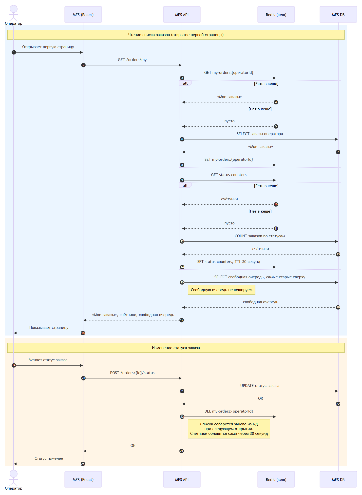

# Архитектурное решение по кешированию

## Что кешируем

**1. Страница операторов в MES.** Операторы жалуются, что она долго грузится.
- **«Мои заказы»** — список маленький и меняется только от действий самого оператора.
- **Счётчики заказов по статусам** — чтобы не пересчитывать все заказы при каждом открытии страницы.

**2. Результат расчёта цены.** Расчёт занимает до 30 минут, а одна и та же модель часто приходит повторно: партнёр присылает заказ ещё раз, в конструкторе собирают одинаковые изделия. Если такую модель уже считали, отдаём цену сразу. При изменении цен на материалы кеш сбрасываем.

## Мотивация

**Почему кеширование.** MES сейчас тормозит, и от этого страдают две группы:
- **операторы** — первая страница MES грузится долго, и они теряют время при каждом открытии;
- **клиенты и партнёры** — расчёт цены идёт до 30 минут, даже если такую модель уже считали.

**Какие проблемы решает:**
- **Страница операторов открывается быстро.** «Мои заказы» и счётчики берутся из кеша, а не пересчитываются в БД каждый раз. Операторы работают быстрее.
- **Повторная модель получает цену сразу.** Партнёры и клиенты быстрее получают результат, заказ раньше уходит в производство.
- **Меньше нагрузка на MES DB.** База у MES одна, и на ней и чтение, и запись. Меньше тяжёлых чтений — быстрее сохраняются заказы и статусы.

**Что включаем в кеширование — всё в MES:**
- «Мои заказы» оператора;
- счётчики заказов по статусам;
- результаты расчёта цены.

## Предлагаемое решение

### Серверное кеширование

Кеш ставим на сервере: Redis рядом с MES API.

Кеш в браузере не подходит:
- счётчики одинаковые для всех операторов, и на сервере их достаточно посчитать один раз;
- цена модели нужна разным клиентам, а браузерный кеш одного клиента другому не поможет;
- сервер не может сбросить кеш в браузере, поэтому оператор будет видеть старые данные.

### Паттерн: Cache-Aside

**Как работает:** сначала смотрим в кеш. Если данные там есть, отдаём их. Если нет — берём из БД и кладём в кеш. Когда данные меняются, удаляем их из кеша.

**Почему не другие:**

| | Cache-Aside | Write-Through | Refresh-Ahead |
|---|---|---|---|
| Как работает | Берём из кеша, если там нет — из БД | При каждой записи обновляем и БД, и кеш | Кеш сам обновляется заранее по расписанию |
| «Мои заказы» | Подходит | Сложно: статус меняют в разных местах, и в каждом нужно не забыть поправить список в кеше | Лишняя работа: обновляет списки всех операторов, даже тех, кто не работает |
| Счётчики | Подходит | Лишняя работа при каждой смене статуса | Подходит, но нужна отдельная фоновая задача для пересчёта |
| Цена модели | Подходит | Не подходит: цену не записывают, а считают | Не подходит: новую модель заранее не знаем, а пересчитывать старые — долго и впустую |

### Диаграмма последовательности

Чтение списка заказов и изменение статуса заказа:

Исходник диаграммы: [sequence-diagram.mmd](sequence-diagram.mmd)

**Сущности в кеше:**

| Ключ | Что хранит | Когда сбрасывается |
|---|---|---|
| `my-orders:{operatorId}` | «Мои заказы» одного оператора | При смене статуса заказа этого оператора или при передаче заказа — сбрасываем списки обоих операторов |
| `status-counters` | Счётчики заказов по статусам | Сам через 30 секунд |
| `price:{хеш 3D-файла}` | Цена модели | При изменении цен на материалы |

### Стратегия инвалидации

Для каждого объекта кеша своя стратегия:

| | Временная (TTL) | По ключу | По событию (программная) |
|---|---|---|---|
| «Мои заказы» | Плохо: оператор видит старый список до истечения TTL | **Подходит:** при смене статуса или передаче заказа сразу удаляем список оператора | Избыточно: сброс по ключу и так точечный |
| Счётчики | **Подходит:** точность до секунды не нужна, раз в 30 секунд обновились | Лишняя работа: сбрасывать при каждой смене статуса любого заказа | Избыточно |
| Цена модели | Плохо: либо зря пересчитываем, либо держим старую цену | Не подходит: при изменении цен на материалы меняются все цены сразу, а не одна | **Подходит:** поменялись цены на материалы — сбросили все цены моделей |

### Сравнение решений

| | Решение 1: только по времени | Решение 2: комбинированное |
|---|---|---|
| Описание и диаграмма | Все записи сбрасываются сами по TTL. Диаграмма — как выше, но без шага 23: при смене статуса кеш не трогаем | «Мои заказы» — по ключу, счётчики — по времени, цена модели — по событию. Диаграмма — выше |
| Плюсы | Максимально просто: в коде ничего сбрасывать не нужно | Данные актуальны: оператор сразу видит взятый заказ, цена пересчитывается после изменения цен на материалы |
| Минусы | Оператор видит старый список до истечения TTL. После изменения цен на материалы отдаём старую цену или зря пересчитываем модели | Чуть сложнее: кеш нужно сбрасывать при смене статуса и при изменении цен |

**Заключение.** Выбираем решение 2. Оно чуть сложнее, но решение 1 оставляет операторов со старым списком заказов и может отдавать клиентам неверную цену, а кеш как раз должен ускорить работу, не теряя точности.
